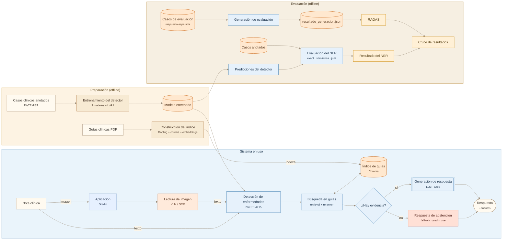
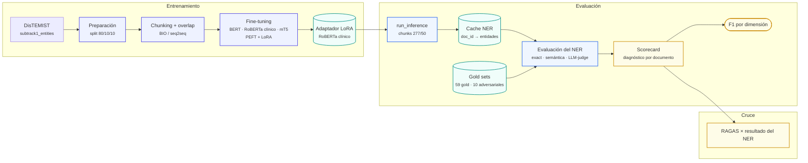
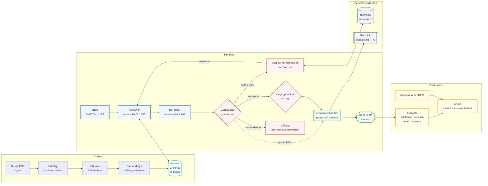
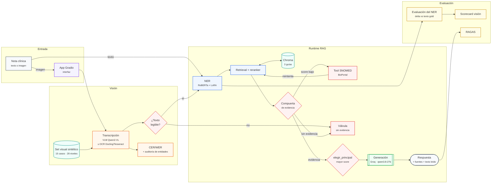

# Diagramas del proyecto

> Estado de `main` en el commit `2958935`.
> El archivo incluye una **vista general** y tres **vistas de detalle** para que el diagrama no se vuelva ilegible.

## 1. Vista general



## 2. Detalle del detector de enfermedades



## 3. Detalle del corpus, búsqueda y generación



## 4. Detalle de visión y app



## Cómo leer los diagramas

- **Celeste claro:** núcleo del pipeline y app.
- **Naranja claro:** datos persistidos y visión.
- **Crema/mostaza:** entrenamiento del detector.
- **Durazno/rojo suave:** decisiones y válvulas (compuerta, `elegir_principal`, fallback).
- **Amarillo suave:** evaluación.
- **Gris:** servicios externos.

> La **vista general** usa la paleta crema con celeste y naranja claros. Los diagramas de detalle conservan la paleta anterior.

## Flujo resumido

```text
Texto:   nota → NER → retrieval → compuerta → generación → respuesta
Imagen:  nota → VLM/OCR → NER → mismo flujo
Eval:    se evalúa el NER · RAGAS evalúa una corrida offline de generación · CER/WER evalúa la visión
```

> **Nota:** el entrenamiento y la evaluación son procesos **offline**. En una solicitud real se usan el modelo entrenado, el detector de enfermedades, el índice de guías, la búsqueda y la generación. La compuerta y `elegir_principal` son reglas deterministas, no modelos.
>
> **RAGAS no evalúa la respuesta en vivo de la app.** Evalúa una corrida offline sobre el eval set del sistema (`resultado_generacion.json`). Por eso el diagrama separa la respuesta de la app de la rama de evaluación.
>
> **Si la compuerta falla:** no se llama al LLM. Se devuelve la válvula de escape (`fallback_used = true`) con el mensaje «No tengo esa información en mis fuentes»; en la app, además, no se elige enfermedad principal.
